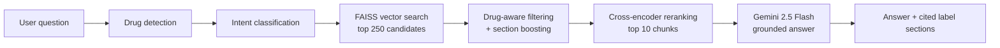

# PharmRAG

**Retrieval-augmented medication question answering, grounded in OpenFDA drug labels.**


PharmRAG answers everyday medication questions ("Can I take ibuprofen while pregnant?", "What are the side effects of metformin?") using only the text of FDA-approved drug labels. Instead of letting a language model answer from memory, it first finds the relevant label sections, then asks the model to answer from those sections alone and to say so when the labels don't cover the question.

> **Disclaimer:** PharmRAG is a research project. It is not medical advice and must not be used to make clinical decisions.

---

## Why this project

General-purpose LLMs can sound confident about drug information while being wrong or out of date. Drug labels are the regulatory source of truth, but they are long and hard to search. PharmRAG connects the two: retrieval brings the right label text to the model, and the prompt keeps the model inside that text.

The project also asks a research question: **do medical-domain embeddings retrieve better evidence than general-purpose ones?** It runs two retrieval pipelines side by side, one with a general embedding model and one with a medical-adapted model, and compares both against an LLM answering with no retrieval at all.

---

## How it works



1. **Drug detection.** Finds the medication(s) named in the question using n-gram, substring and token matching against the label vocabulary.
2. **Intent classification.** Tags the question as usage, dosage, side effects, interactions, pregnancy or warnings, so the matching label sections can be prioritized.
3. **Vector search.** Embeds the question and retrieves the 250 nearest label chunks from a FAISS index.
4. **Filtering and boosting.** Softly filters candidates to the detected drug(s) and boosts sections that match the intent (for example, the *Pregnancy* section for a pregnancy question).
5. **Reranking.** A medical cross-encoder rescores the remaining candidates and keeps the top 10.
6. **Grounded generation.** Gemini 2.5 Flash writes the answer from those chunks only, puts warnings and contraindications first, and states clearly when the labels don't contain the answer.

---

## Models

| Role | Model |
|---|---|
| Medical embeddings | [`aleynahukmet/bge-medical-small-en-v1.5`](https://huggingface.co/aleynahukmet/bge-medical-small-en-v1.5) |
| General embeddings (comparison) | `BAAI/bge-small-en-v1.5` |
| Reranker | [`dranreb1660/medimaven-reranker-bge-cross-encoder`](https://huggingface.co/dranreb1660/medimaven-reranker-bge-cross-encoder) |
| Generator | `gemini-2.5-flash` (Google Gemini API) |

---

## Data

- **Source:** [OpenFDA drug label dataset](https://open.fda.gov/apis/drug/label/)
- **Scale:** ~100K drug labels, split into section-aware chunks and indexed with FAISS (inner-product similarity)
- **Index files** the code expects in `embeddings/bge-medical/`:
  - `embeddings-bge-medical-final-800.npy`: chunk embeddings
  - `metadata-bge-medical-final-800.jsonl`: chunk text, drug name and label section for each vector
  - `index-faiss-ip.bin`: FAISS index

The index files are not included in this repository because of their size.

---

## Evaluation

PharmRAG was evaluated on 150 consumer-style medication questions, comparing three systems:

1. Gemini with **no retrieval** (ungrounded baseline)
2. RAG with **general** embeddings (`bge-small`)
3. RAG with **medical** embeddings (`bge-medical`)

Answers were scored with an **LLM-as-judge rubric** (factuality, safety coverage, clarity) and with **ROUGE** against label text.

**Result:** the medical-embedding pipeline outperformed both the general-embedding pipeline and the ungrounded baseline on every criterion.

`evaluation.py` reads the questions from `best-150-questions.txt` (one per line) and writes every generated answer to `150-rag-answers.json` for scoring.

### Typical latency

| Stage | Time |
|---|---|
| FAISS retrieval | ~200 ms |
| Reranking | ~500 ms |
| Generation | ~2–4 s |
| **End to end** | **~3–5 s per question** |

---

## Getting started

### Requirements

- Python 3.10+
- A [Google Gemini API key](https://aistudio.google.com/app/apikey)
- The index files (see [Data](#data))

### Install

```bash
git clone https://github.com/MujtabaGit56/PharmRAG.git
cd PharmRAG
pip install -r requirements.txt
```

### Configure

```bash
export GEMINI_API_KEY="your-key-here"        # Windows PowerShell: $env:GEMINI_API_KEY="your-key-here"
```

By default the index is read from `embeddings/bge-medical/` inside the project. To keep it somewhere else, point `PHARMRAG_EMB_DIR` at that folder:

```bash
export PHARMRAG_EMB_DIR="/path/to/bge-medical"
```

To run the general-embedding pipeline instead, swap the commented `BGE-GENERAL` block at the top of `retrieval_from_rag.py` for the `BGE-MEDICAL` one.

### Run

```bash
streamlit run user_interface.py     # web app with query analysis and sources
python llm_inference.py             # command-line Q&A
python retrieval_from_rag.py        # test retrieval only, no LLM call
python evaluation.py                # run the 150-question evaluation
```

### Retrieval settings

| Setting | Default | Meaning |
|---|---|---|
| `FAISS_K` | 250 | Candidates pulled from the vector index |
| `TOP_K` | 10 (`llm_inference.py`), 8 (`retrieval_from_rag.py`) | Chunks kept after reranking |
| `RERANK_BATCH_SIZE` | 32 | Batch size for the cross-encoder |

---

## Project structure

```
PharmRAG/
├── drug_detection.py         # find drug names in the question
├── retrieval_from_rag.py     # intent classification, FAISS search, filtering, reranking
├── llm_inference.py          # grounded prompt + Gemini generation (CLI)
├── user_interface.py         # Streamlit app
├── evaluation.py             # 150-question evaluation run
├── embeddings/
│   └── bge-medical/          # index files (not included)
├── requirements.txt
└── README.md
```

---

## Safety design

- Answers draw only on retrieved FDA label text, not on the model's general knowledge.
- Warnings, contraindications and boxed warnings are surfaced first.
- When the retrieved sections don't answer the question, the system says so instead of guessing.
- Every answer shows the label sections it was based on.

---

## Limitations

- Coverage is limited to what is in the FDA labels; it does not include clinical guidelines, newer research or non-US products.
- Drug detection works best for common medications and may miss misspellings or uncommon brand names.
- LLM-as-judge scoring is useful for comparing systems but is not a substitute for review by pharmacists or clinicians.

---

## Author

**Mujtaba Shahid**, MS Artificial Intelligence, NUST
[LinkedIn](https://linkedin.com/in/mujtabashahid) · [GitHub](https://github.com/MujtabaGit56)

## License

Released under the [MIT License](LICENSE).
